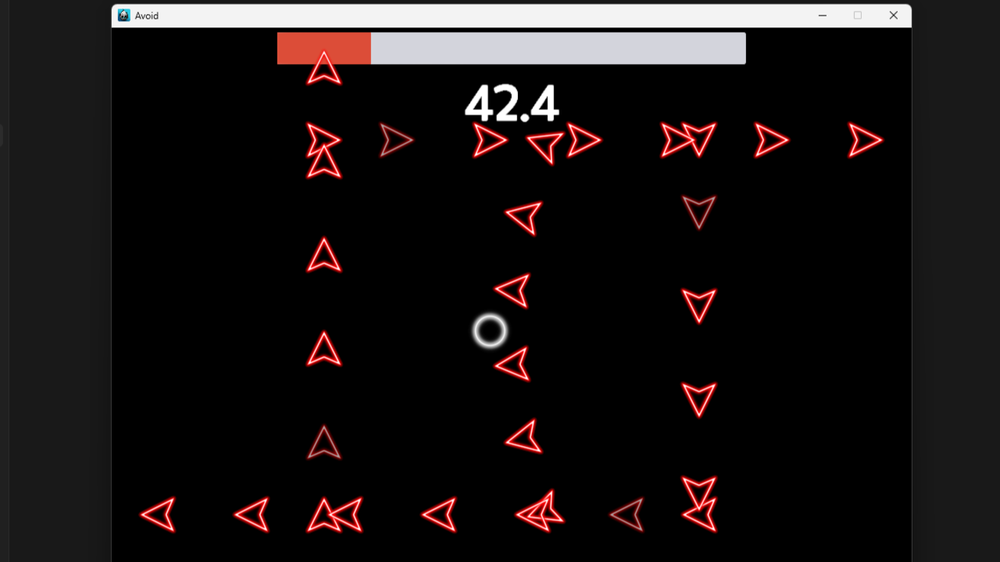
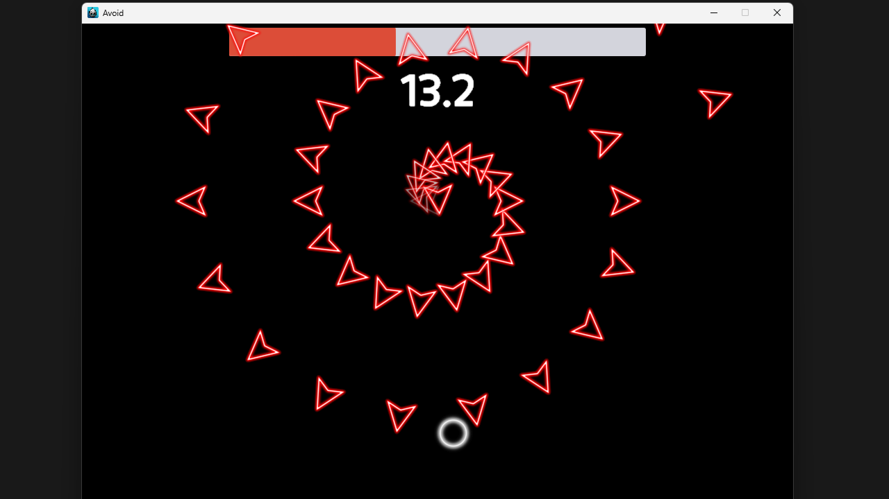
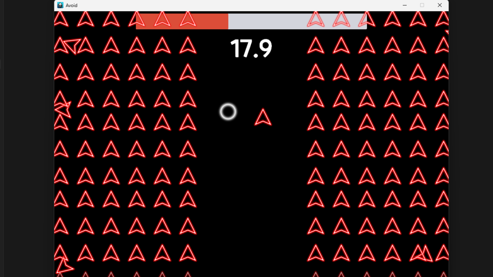

# Avoid

> 📌 모바일을 타깃으로 만든 닷지류 게임입니다. 다양한 탄막 패턴을 피해 오래 생존하는 것이 목표입니다.

<p align="left">
  
  
  
</p>

🔗 [문서](https://abaft-yarn-52e.notion.site/Avoid-1e6c32f2552880a88033f40a8fefe495?pvs=74)

`Avoid/Classes/`의 코드는 모두 제가 직접 작성한 부분입니다.

---

## 📂 폴더 구조

```
Avoid/Classes/
├── Pattern/     # 탄막 패턴 (ArrowPattern + 8종)
├── Arrow/       # 탄환 · 오브젝트 풀
├── Player/      # 플레이어 · 체력
├── UI/          # HUD · 체력바 · 시간 · 조이스틱
├── Scene/       # 타이틀 · 게임 씬
├── Effect/      # 카메라 흔들림
└── Core/        # Delegate · 공용 Enum
```

---

## 🔹 핵심 구조

### 탄막 — `Pattern/`, `Arrow/`
- `ArrowPattern` 추상 클래스(`start` · `update` · `reset` · `isCompleted`)를 상속해 `Circle`, `Dragon`, `Fork`, `OneToOne`, `RightAndLeft`, `Sector`, `Square`, `Stay` 8가지 패턴을 구현했습니다.
- `GameScene`의 `Pattern Queue`가 패턴을 순서대로 실행해 자유롭게 조합할 수 있습니다.
- 탄환은 싱글톤 `ArrowPool`에서 꺼내고 반납해 생성 · 파괴 비용을 줄였습니다.

### UI — `UI/`
- `TimeCount`(모델) · `TimeView`(뷰) · `UIController`(컨트롤러)로 나눈 MVC 구조로 UI를 모듈화했습니다.
- `BloodScreen`, `GameOver`, `HealthBar`, 조이스틱을 한 곳에서 관리하고, `HealthBar`는 9-Slice로 텍스처 깨짐을 해결했습니다.

### 이벤트 — `Core/Action.h`
- `std::function`과 가변 인자 템플릿으로 `Delegate`를 직접 구현해 체력 변화 등 이벤트를 느슨하게 연결했습니다.

### 연출 · 빌드 — `Effect/`
- `ActionInterval`을 상속한 `CameraShakeAction`으로 피격 시 카메라 흔들림을 연출합니다.
- Android Studio로 APK를 빌드해 실제 기기에서 테스트했습니다.
